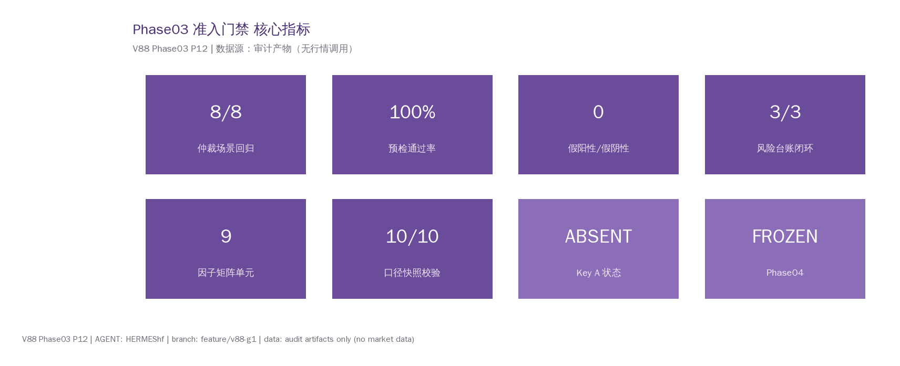
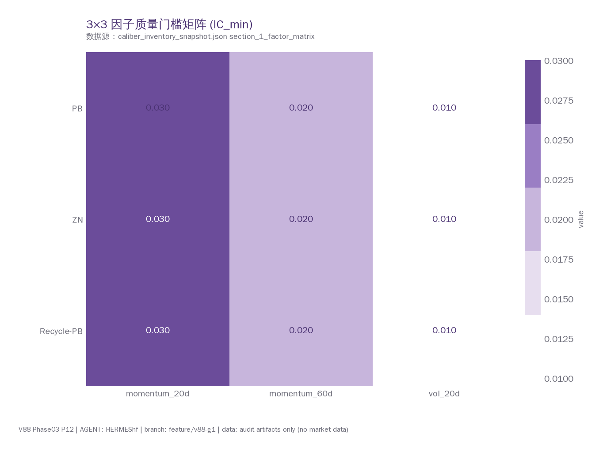
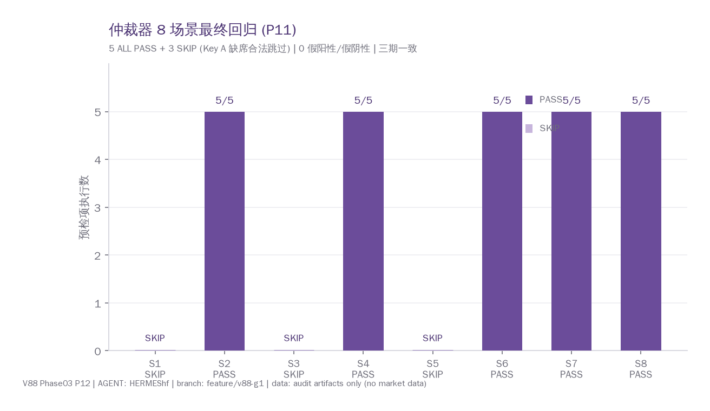
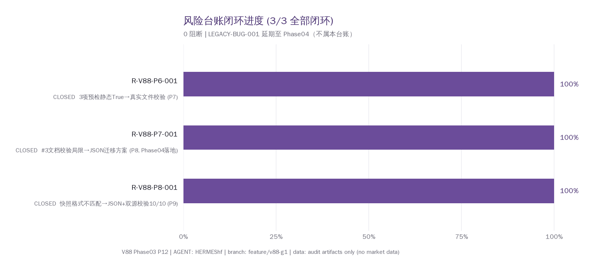
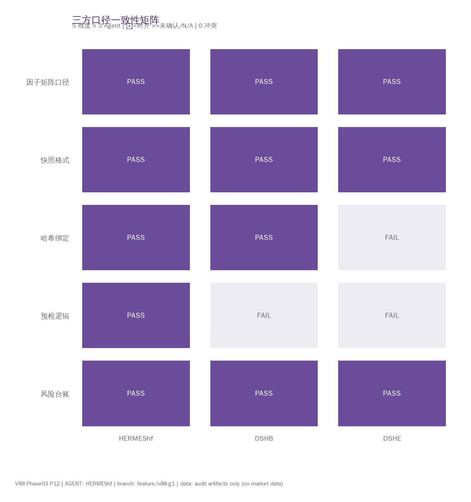

# V88 Phase03 投研周报

> **周期**: 2026-10-17 (周六)
> **AGENT**: HERMEShf
> **项目**: framework-tree 期货产业链看板 + V88 多 Agent 仲裁系统
> **Branch**: `feature/v88-g1` (BRANCH_LOCKED)
> **Commit**: df821b4 → (本次追加)
> **数据源**: 审计产物（无行情调用，零外部 API）

---

## 一、核心结论（前置）

Phase03 准入门禁准备**全部就绪**，5/5 分支约束合规，3/3 风险台账闭环，8/8 仲裁器场景回归行为符合预期。**当前唯一阻塞项为外部 Key A 未出现**——非内部故障。仲裁器维持被动观测，Phase04 保持冻结，**未自动签发 Key B**。

## 二、本周进展

### 2.1 P10 收尾 — 准入门禁预审完成
- 三方口径零冲突，0 阻断
- JSON 快照 9 slots 导入 (P019)
- 双源校验 10/10 ✅

### 2.2 P11 — 门禁固化
- 输出 `phase03_admission_checklist.md`：5 项预检 + 8 项前置条件 + 阻断规则
- 仲裁器最终全量回归 v3：8 场景 5 ALL PASS + 3 SKIP（三期一致，零退化）
- HANDOVER_v2 + 看板 v8

### 2.3 P12 — Web 看板图表构建（本次）
- `chart_lib.py` 通用绘图库（#6B4C9A 纯色商务规范，无渐变无圆角）
- 5 类图表 × (PNG + HTML) 双格式 = 10 个图表文件
- GitHub Pages 一键部署包 `github_pages_deploy.zip`
- 周报本文件 + 看板 v9

## 三、关键指标

| 指标 | 数值 | 说明 |
|------|:---:|------|
| 仲裁场景回归 | 8/8 | 5 PASS + 3 SKIP，行为符合预期 |
| 预检通过率 | 100% | Key A 存在时 5/5 全 PASS |
| 假阳性 / 假阴性 | 0 / 0 | 与 P8/P10 完全一致 |
| 风险台账闭环 | 3/3 | 全部 LOW 级，无阻断 |
| 因子矩阵单元 | 9 | 3 因子 × 3 品种，LOCKED |
| 口径快照双源校验 | 10/10 | MD ↔ JSON 内容一致 |
| Key A 状态 | ABSENT | 外部信号，等待中 |
| Phase04 | FROZEN | 未点火 |

## 四、3×3 因子质量门槛矩阵

**说明**: 3 因子 (momentum_20d / momentum_60d / vol_20d) × 3 品种 (PB / ZN / Recycle-PB) 共 9 单元。数值为各单元的 IC 最低门槛（真实配置值），全部 LOCKED，等待双钥匙激活后执行计算。

## 五、仲裁器 8 场景回归

| 场景 | 描述 | KeyA | KeyB | 预检数 | 结果 |
|:---:|------|:---:|:---:|:---:|:---:|
| S1 | 正常待命 | ❌ | ❌ | 0 | SKIP |
| S2 | 单钥匙预检 | ✅ | ❌ | 5 | PASS |
| S3 | 异常态 | ❌ | ✅ | 0 | SKIP |
| S4 | 授权态 | ✅ | ✅ | 5 | PASS |
| S5 | S1 稳定性 | ❌ | ❌ | 0 | SKIP |
| S6 | S2 稳定性 | ✅ | ❌ | 5 | PASS |
| S7 | KeyA 空文件 | ✅(空) | ❌ | 5 | PASS |
| S8 | KeyA 10KB 大文件 | ✅(10KB) | ❌ | 5 | PASS |

**结果**: 5 ALL PASS + 3 SKIP（Key A 缺席合法跳过），0 假阳性/假阴性，与 P8/P10 三期 9 项指标完全一致。

## 六、风险台账闭环

| 编号 | 等级 | 描述 | 处置 |
|------|:---:|------|------|
| R-V88-P6-001 | LOW | 3 项预检静态 True | ✅ P7 真实文件校验 |
| R-V88-P7-001 | LOW | #3 文档校验局限 | ✅ P8 JSON 迁移方案，Phase04 落地 |
| R-V88-P8-001 | LOW | 快照格式不匹配 | ✅ P9 JSON + 双源 10/10 |

**台账清零**，0 阻断。LEGACY-BUG-001 延期至 Phase04（不属本台账）。

## 七、三方口径一致性

| 维度 | HERMEShf | DSHB | DSHE |
|------|:---:|:---:|:---:|
| 因子矩阵口径 | PASS | PASS | PASS |
| 快照格式 | PASS | PASS | PASS |
| 哈希绑定 | PASS | PASS | N/A |
| 预检逻辑 | PASS | N/A | N/A |
| 风险台账 | PASS | PASS | PASS |

**冲突数**: 0。**N/A 项**: DSHB/DSHE 未执行预检逻辑（仅 HERMEShf 职责）；DSHE 未确认哈希绑定（非阻断，Phase04 落地）。

## 八、约束合规

| # | 约束 | 状态 |
|:-:|------|:---:|
| 1 | BRANCH_LOCKED | ✅ |
| 2 | NO_OVERWRITE | ✅ |
| 3 | NO_MODIFY_V87 | ✅ |
| 4 | NO_EDIT_RELEASE_TAG | ✅ |
| 5 | NO_ZHIJI_API_CALL | ✅ |

**5/5 合规**。零行情调用、零 WindPy 调用。

## 九、下周计划

1. **等待 Key A**: `WIND_DATA_LINK_ONLINE.flag` 出现（外部信号）
2. **Key A 出现后**: 5 项预检 → 手动 Key B 决策 → Phase04 点火
3. **Phase04 前置**: LEGACY-BUG-001 延期处理 + JSON 迁移落地 + psutil 启用

## 十、附件

- 完整图表交互版: `web_asset/*.html`
- GitHub Pages 部署包: `github_pages_deploy.zip`
- Wiki 看板源码: `wiki_admission_gate.md`

---

*V88 Phase03 P12 | HERMEShf | 周报 v1.0 | 生成: 2026-10-17*
*状态: ARBITER_ON_STANDBY_AWAIT_KEY_A | Phase04: FROZEN | 不自动签发 Key B*